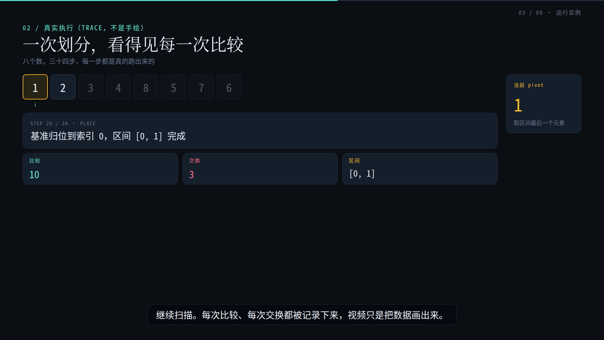
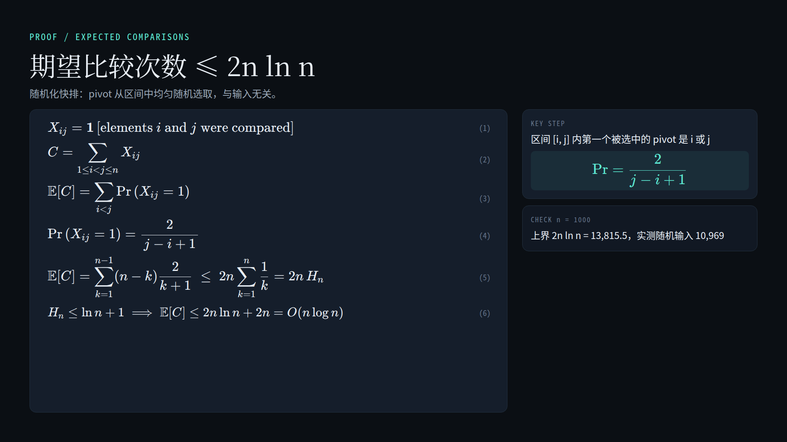
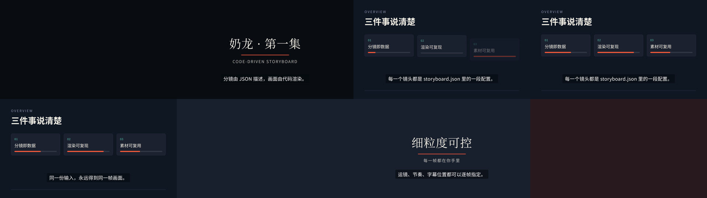
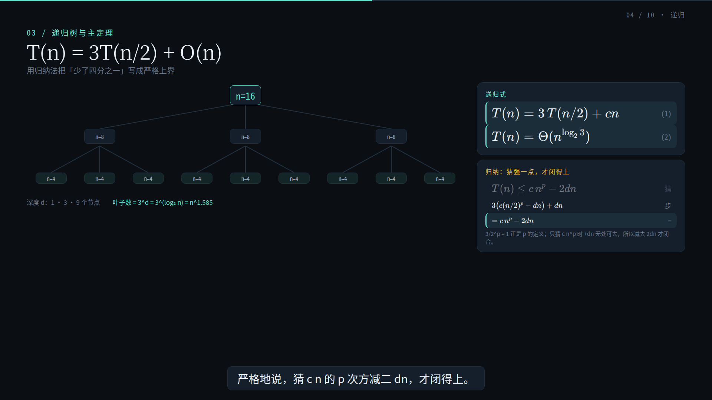
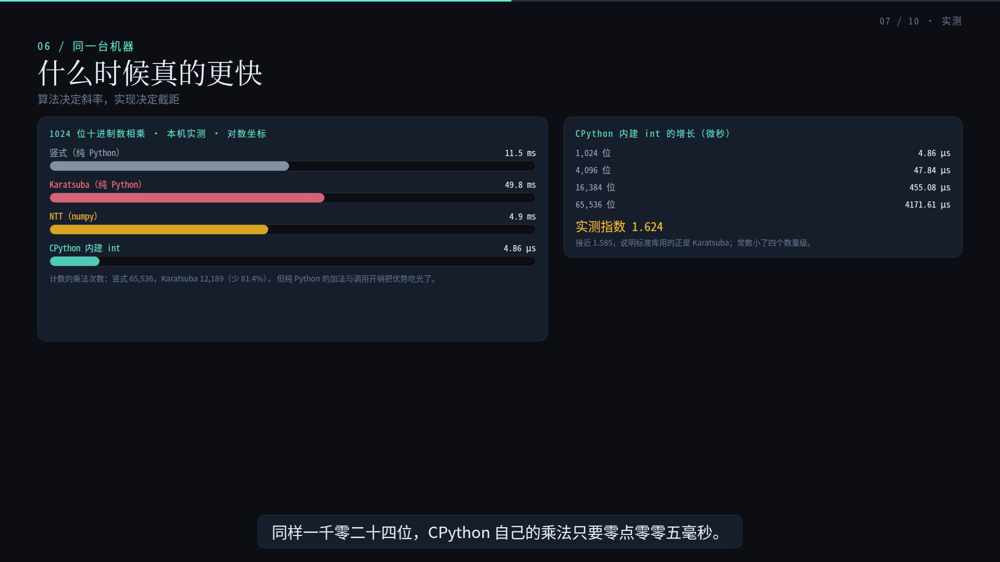

# video-pipeline-blueprint

A verified, reproducible blueprint for a **code-driven video pipeline**: the storyboard is data,
the picture is code, the sound is generated, and acceptance is measured instead of argued.

This repository is not a library. It is a **reference deployment + field report**: one production
(305 s algorithm lecture, Mandarin narration, programmatic score) that was built end to end on a
single 8 GB laptop GPU, with the exact environment, scripts, failure modes and quality gates that
made it work. Everything here was executed; numbers below were measured, not estimated.

```
Status: reference implementation, v1.0.0. Demo: 305 s / 1920x1080 / 30 fps / h264 + aac,
integrated loudness -15.1 LUFS, true peak -1.8 dBTP, 41 narration lines.
```

**Watch it first:** [the demo film](https://github.com/Xian-debu/video-pipeline-blueprint/releases/download/v1.0.0/quicksort_v3.mp4)
(14.6 MB, release asset) - then read how it is guaranteed to render the same way every time.

## 中文速览

这是一个**经过实测验证**的代码驱动视频管线部署包：分镜是数据（JSON/TS），画面是代码（Remotion/React），
声音是本地合成的（IndexTTS-2 旁白 + 种子确定性配乐），验收靠测量而不是靠嘴（EBU R128 响度、逐帧亮度
闪烁检测、静帧人工复核）。本仓库收录的是两份完整生产案例——一台 8 GB 笔记本显卡机器上产出的 305 秒
快速排序教学片，以及 591 秒的「逐位乘法演进」科普片——以及让它们跑起来所需的脚本、环境说明、失败模式和验收关卡。

不是库，不是 SaaS，不是一键安装器。目标是：克隆下来，`bash scripts/bootstrap.sh` +
`npm run verify` 两分钟内得到 PASS，然后照着 `docs/deployment.md` 换成你自己的内容。
坑都在 `docs/known-issues.md`（K1–K17），没有一条是假设出来的。

## 1. What this is, and what it is not

| It is | It is not |
| --- | --- |
| A deployment guide whose every step has been run on a clean directory | A hosted service, SaaS, or a one-click installer |
| A working Remotion project (generic storyboard + validated lecture) | A video editing GUI |
| Objective QA gates: EBU R128 loudness, per-frame luma flicker detection, still-frame review | An "AI makes your video" wrapper |
| Honest notes on what broke and why (see `docs/known-issues.md`) | A claim that any of this is trivial |

The core idea is simple: **a frame is a pure function of (data, frame index)**. If that holds,
a video becomes testable — you can render frame 2500 in isolation, diff it, and re-render the whole
film deterministically. Almost every design decision here follows from that.

## 2. Verified result

The demo is a 5-minute lecture on quicksort (from intuition to optimisation to a full expected-case
proof), generated from:

- real execution traces: 34 partition steps on an 8-element array, captured from an instrumented
  Python implementation (no hand-drawn values),
- measured counters: 5 sort variants x 4 input patterns, n = 1000, on the same machine,
- 41 narration lines synthesized locally (IndexTTS-2) and re-timed against measured speech lengths,
- a 306 s score rendered deterministically from a seed (same seed => identical wav bytes).

| Property | Measured |
| --- | --- |
| Runtime | 305.100 s, 30 fps, 1920x1080 |
| Video | h264, yuv420p |
| Audio | aac 48 kHz, I = -15.1 LUFS, TP = -1.8 dBTP |
| Full render time | ~5 min on the reference machine (2 concurrent renderers) |
| Flicker gate | max single-frame luma delta 9.68 (< 12 threshold) |
| Reproducibility | same seed => same music bytes; stills are frame-exact |

### Stills from the verified run

| | |
| --- | --- |
|  |  |
| Trace scene: real partition steps, live pivot slot, per-step counters | Proof scene: six numbered KaTeX lines, key step, measured check |
|  |  |
| Generic `Storyboard` composition driven by storyboard JSON | Contact sheet of the 30 s `Showreel` (the verify artefact) |

The same template in two other presets — [paper](docs/images/still_preset_paper.png) (dark on light)
and [slate](docs/images/still_preset_slate.png) (cool dark) — is how a look gets reviewed: one still
per preset, rendered by the same code path, checked by the same DOM rules.

### The second film: digit-wise multiplication

`Multiplication` (composition id `Multiplication`, doc `docs/multiplication.md`) is a 9-minute-48
explainer on how computers multiply big numbers: schoolbook n² → Karatsuba → Toom-3 → FFT/NTT →
the constant-factor magic real libraries use. Every number on screen is either counted by a script
(`data/mult/*.json`, regenerated by `scripts/generate_mult_data.py`) or measured on the reference
machine; the four proofs are typeset with KaTeX, and the code scene highlights the line CPython is
actually executing.

| Property | Measured |
| --- | --- |
| Runtime | 587.900 s, 30 fps, 1920x1080 |
| Audio | aac 48 kHz, I = -15 LUFS, TP = -2 dBTP |
| Narration | 106 lines, IndexTTS-2, re-timed against measured speech (`587.87 s`, 0 overruns) |
| Flicker gate | max single-frame luma delta 8.74 across 9 hard cuts (threshold 12) |
| Deliverables | 106 SRT cues (0 wrapped), 10 chapters, cover |
| sha256 | `af276de189cbf923684f986f65ff950d8e4455c91e088ff8079762b92e3ced17` |

| | |
| --- | --- |
|  |  |
| The strengthened induction (guess `c·nᵖ − 2dn`, not `c·nᵖ`, or the step cannot close) | Same-machine benchmark; the CPython bar and the growth table come from one measurement |

## 3. Pipeline at a glance

```
data/lecture/*.json ──► src/lecture/script.ts ──► src/lecture/Lecture.tsx ──► Remotion render
(real traces)      (scene budget, lines)       (scenes + subtitles)         │
                                                                             ├─► stills (human review)
IndexTTS-2 ──► public/voice/lNN.wav ──► narration.wav ──────────────────────┤
node-web-audio-api ──► public/music/score.wav ──► mix.mjs (duck, fades) ──────┤
                                                                            ▼
                                                              ffmpeg loudnorm (EBU R128)
                                                                            │
                                                              luma_blink.py (flicker gate)
```

Three independent layers, joined only by files:

1. **Content** — storyboard JSON or a typed `script.ts`; scene durations and speech lines are data.
2. **Rendering** — React/TSX components driven exclusively by `useCurrentFrame()`; no CSS
   animations, no third-party self-running animation, so any frame can be rendered in isolation.
3. **Sound** — a deterministic score (seeded PRNG, `node-web-audio-api`) and a locally synthesized
   narration track, mixed outside the renderer (`scripts/audio/mix.mjs`: ducking, fades, peak guard)
   and normalised with ffmpeg. A score is only "there" if it survives a 300 Hz high-pass, so
   `scripts/qa/music_gate.py` measures the band that actually reaches a laptop speaker.

## 4. What is in the box

```
.
├─ src/
│  ├─ Root.tsx                 registered compositions (9)
│  ├─ storyboard/              generic template: storyboard JSON -> film
│  ├─ lecture/                 the validated 305 s lecture (script + scenes)
│  ├─ mult/                    the second film, 591 s: digit-wise multiplication (script + scenes)
│  ├─ design/                  design contract loader + derived tokens, palette scope (presets),
│  │                           scene shell, KaTeX helpers, motion primitives, still-lint probe
│  │                           (inert unless lint props are set)
│  └─ showcase/                one-file samples: transitions, typesetting, 3D, Manim overlay,
│                              preset gallery (one look per preset)
├─ data/                       shared contract only: design.spec.json, type-exceptions.json
│  ├─ lecture/                 the quicksort film's own facts: trace, counters, source, voice timing
│  └─ mult/                    the multiplication film's own facts: counts, benchmarks, NTT, code, voice
├─ public/voice/sample.wav     one narration line, kept so the audio path can be tested without TTS
├─ scripts/
│  ├─ bootstrap.sh             system libraries, node, npm, headless Chromium
│  ├─ doctor.sh                read-only environment report (PASS/FAIL)
│  ├─ verify.sh                end-to-end smoke test: typecheck -> stills -> render -> QA
│  ├─ make.mjs                 one command for one delivery: every gate, in order, into report.json
│  ├─ generate_data.py         regenerates data/lecture/*.json from instrumented implementations
│  ├─ generate_mult_data.py    the same for the multiplication film: counts, benchmarks, trace
│  ├─ audio/render_music.mjs   deterministic score renderer
│  ├─ audio/mix.mjs            narration + score mix: ducking, fades, peak guard (no re-render)
│  ├─ audio/loudnorm.sh        two-pass EBU R128 normalisation (video stream untouched)
│  ├─ qa/music_gate.py         score audibility: power in 250-4k Hz, and the bed level in pauses
│  ├─ qa/luma_blink.py         per-frame luma jump + dip detector
│  ├─ qa/design_check.py       validates the design contract (contrast, scale, families, motion)
│  ├─ qa/type_ratchet.py       no new hard-coded font sizes: the exception list may only shrink
│  ├─ qa/still_lint.mjs        renders frames, reads the DOM boxes, fails on off-frame/edge/spill/overlap
│  ├─ qa/film_isolation.mjs    one film may not read another film's data or source (layout rule)
│  ├─ export/publish.mjs       SRT + chapters + cover, all derived from the lecture script
│  └─ tts/                     local TTS: batch synthesis, re-timing, torchaudio patch
├─ docs/                       architecture, engineering standards, design language (provenance of
│                              the contract), deployment, verification, known issues, roadmap
├─ AGENTS.md                   rules for AI agents working in this repo
├─ CONTRIBUTING.md             how to change things, and what "done" means here
├─ package-lock.json           pinned dependency tree (306 packages, installed with npm ci)
└─ THIRD_PARTY_NOTICES.md      licences: npm packages, system tools, TTS models, reference reading
```

Compositions: `Storyboard` (generic, 20 s), `Showreel` (30 s), `Lecture` (305 s demo),
`Multiplication` (591 s demo, the second film), `Transitions`, `Typesetting`, `ThreeCube`,
`ManimOverlay` (single-capability samples) and `Presets` (9 s: the same title scene in each palette
preset, for judging a look).

One command runs the whole delivery. `npm run make` walks the stages in the order that makes a
failure cheapest to fix — contract, score, score gate, picture-only render, review stills, still
lint, mix, mix gate, mux, loudnorm, flicker, exports — and writes `out/<name>/report.json` with the
exit code of every stage and every measured number (loudness, true peak, flicker max, still box
counts). A failing stage stops the run and still writes the report, so a failure is a file, not a
scrollback. The score is generated *before* the picture on purpose: a bed that fails the audibility
gate must not be able to reach a render.

```bash
npm run make -- --composition Lecture --narration public/voice/narration.wav --skip-static
npm run make -- --composition Storyboard --cut-frames 120,240,270   # a template with hard cuts
```

The film's delivery set is `npm run publish`: `out/export/` gets an SRT (41 cues, wrapped to the
contract's 34-character line budget), human-readable and ffmpeg-sidecar chapter files (9 chapters,
summing to the film's duration) and a cover rendered from frame 180. Nothing in that folder is
authored by hand, so it cannot drift from the picture.

Type is a contract question, not a scene one. The storyboard template reads `SB.*` and `SB_T.*`
(sizes, tracking) from `type.families.storyboard`, so changing the template's type means editing one
JSON file. The validated film's own sizes are *grandfathered* in `data/type-exceptions.json` (52
literals across 9 files, mostly the lecture's chrome) rather than promoted into the contract, and
`scripts/qa/type_ratchet.py` fails the build when a literal is added, duplicated or left stale — the
list can only shrink.

Colour is a preset of the same role contract. A scene names a role (`text.primary`,
`accent.primary`, `surface.scrim`) and never a hex value; `PaletteScope` decides which family
answers those roles. `palette.presets` in the contract names the looks — `midnight` (the shipped
film's family, and the pinned default), `paper` (light, warm) and `slate` (cool) — and
`design_check.py` runs every preset family through the same contrast rules, then refuses a default
that is not the family the released film was reviewed in. Switching a look is one prop:

```bash
node scripts/qa/still_lint.mjs --compositions Presets --frames 135   # the paper look, DOM-checked
npx remotion render Storyboard out/paper.mp4 --props='{"preset":"paper"}'
```

## 5. Quick start

```bash
# 0. prerequisites: Debian/Ubuntu, ffmpeg, python3 + numpy, ~5 GB free disk; sudo for the apt step
#    (bootstrap.sh installs all of these; the QA gate needs numpy)
git clone <this repo> && cd video-pipeline-blueprint
bash scripts/bootstrap.sh        # apt libs + CJK fonts + node + npm + headless Chromium
bash scripts/doctor.sh           # must print "all checks passed"
npm run verify                   # ~2 min: typecheck, 3 stills, 30 s film, loudness + flicker gates
```

Expected tail of `npm run verify`:

```
integrated loudness = -15.XX LUFS, true peak = -2.XX dBFS
PASS loudness
... flicker: PASS
verify: PASS — stills in out/verify/, video in out/verify/showreel_norm.mp4
```

Then:

```bash
npm run studio                                   # live preview in the browser
npx remotion still Lecture out/frame_2500.png --frame=2500 --props='{"music":null,"narration":null}'
npx remotion render Lecture out/lecture.mp4      # needs public/music/score.wav (see docs/deployment.md)
```

## 6. The environment this was built on

| Item | Value |
| --- | --- |
| Host | Windows 11 + WSL2 (Ubuntu 24.04.2 LTS), mirrored network mode |
| GPU | NVIDIA RTX 5070 Laptop, 8 GB VRAM, driver 591.44 |
| CPU / RAM | 20 logical cores / 54 GB (WSL limit) |
| Node | v22.21.1 (tarball, not the distro package) |
| Remotion | 4.0.536, Chromium renderer `angle` |
| ffmpeg | 6.1.1 |
| Python | 3.12.3; a side venv holds Manim 0.22 and the TTS stack |

**How these long jobs are controlled** matters as much as the versions:

- Renders are single-shot CLIs; they are *not* run from an interactive shell that can die.
  On the reference machine every long job runs under a supervisor:
  `systemd-run --unit=lecture --collect --property=StandardOutput=file:/tmp/lecture.log ...`
  and progress is read from the log. Detaching with `nohup`/`setsid` from a session that then
  exits lost processes in our tests.
- The pipeline never polls an LLM or a remote API during a render; the render is a pure function,
  so a retry costs only wall-clock time.
- Peak VRAM is dominated by the TTS model (~7.9 GB of 8 GB). **Do not run TTS and a 3D render
  concurrently on an 8 GB card.** Rendering itself is CPU-bound and does not need the GPU.
- Headless Chromium on WSL2 needs the shared libraries listed in `scripts/bootstrap.sh`; the
  renderer uses ANGLE for WebGL, which is also what makes 3D scenes work on an 8 GB machine.

## 7. Models, libraries and the relationship to upstream projects

This repository contains **only original code and data**. It does not vendor, mirror, or
re-license any third-party weights or sources; every dependency is installed by the user from
its own upstream under its own license.

| Upstream | Role here | License (upstream) | Relation |
| --- | --- | --- | --- |
| [Remotion](https://github.com/remotion-dev/remotion) 4.0.536 | React-based video renderer; every composition | Remotion License (free for individuals/small teams; check company terms) | Unmodified dependency; this repo is an application built on its public API |
| [React](https://github.com/facebook/react) 19 / [three.js](https://github.com/mrdoob/three.js) / [react-three-fiber](https://github.com/pmndrs/react-three-fiber) | scene components, 3D sample | MIT | dependency |
| [KaTeX](https://github.com/KaTeX/KaTeX) | math typesetting in the proof scene | MIT | dependency |
| [Manim Community](https://github.com/ManimCommunity/manim) 0.22 | optional: animated formula overlay (alpha) | MIT | external renderer, its output is imported as a video asset |
| [IndexTTS-2](https://github.com/index-tts/index-tts) | local Mandarin narration | Apache-2.0 (check upstream) | external model runtime; weights are downloaded by the user, never committed here |
| [torchaudio](https://github.com/pytorch/audio) / [soundfile](https://github.com/bastibe/python-soundfile) | audio IO in the TTS path | BSD-2 / BSD-3 | dependency; one compatibility patch is applied by a script, not vendored |
| [node-web-audio-api](https://github.com/ircam-ismm/node-web-audio-api) | offline score synthesis | BSD-3 | dependency |
| [ffmpeg](https://ffmpeg.org) | loudness measurement/normalisation, encoding checks | LGPL/GPL depending on build | external binary |
| [Noto fonts](https://github.com/notofonts/noto-cjk) | CJK typography | OFL-1.1 | installed as a system font, not bundled |
| [remotion-skills](https://github.com/buainoai/remotion-skills) | external best-practice rules consulted while building | see upstream | **not** included; referenced as reading material |

Deliberately not used: the official `@remotion/mcp` (it only forwards documentation to
`mcp.remotion.dev`; it does not render), Tone.js (its `OfflineAudioContext` path is unusable in
Node — see `docs/known-issues.md` K2), and any cloud TTS.

## 8. Verification: what `npm run verify` actually proves

```
1/6  typecheck          tsc --noEmit
1.2  design contract    design_check.py: contrast ratios, type ladder + families, tracking
                        ratios, motion budgets
1.25 type ratchet       type_ratchet.py: no new hard-coded fontSize/letterSpacing literals
1.3  still lint         still_lint.mjs: 24 frames measured from the DOM (off-frame, edge,
                        spill, overlap) + a fixture that proves the rules still fire
2/6  stills             Storyboard f60, Lecture f2500, Typesetting f60  -> human review
3/6  score              deterministic wav from seed 11 (32 s)
3.4  music self-test    music_gate.py --self-test: a sub-only bed must still be rejected
3.5  music gate         music_gate.py: >= 50% of power in 250-4k Hz, <= 20% in 20-120 Hz
4/6  render             Showreel 30 s, h264 + aac
5/6  loudness           two-pass loudnorm; asserts I in [-16,-13] and TP <= -1.5
6/6  flicker            per-frame luma jumps on the whole frame (threshold 12)
```

The design-contract step is cheap and catches the class of defect that is cheapest to fix before a
render: a role that fails contrast on one of its real backgrounds, a type size that is not on the
ladder, a motion duty whose budget exceeds its cap. It prints every measured ratio, so a reviewer can
see the margin rather than the verdict.

The still-lint step is the machine version of "look at the frame", for the four failures a machine
can name: a box outside the 1920x1080 canvas, text closer than 24 px to the edge, a text range wider
than the box it was given, and two text boxes sharing more than a quarter of the smaller one. It does
not try to judge taste, and it cannot be fooled by a frame with no measurement — a frame that reports
zero boxes is a **failing** gate (exit 2), not a pass.

What it does **not** prove: narration quality (needs the TTS model), Manim overlay (needs the asset),
or 3D on a GPU-less host. Those are separate, optional passes in `docs/deployment.md`.

The stills are not decoration. In this production, two defects that every automated metric passed —
a subtitle overlapping a title, and four proof panels leaving the frame — were only caught by
looking at rendered frames. Treat "human reviews stills" as a required stage, not a nice-to-have.

## 9. Known issues

Full detail in `docs/known-issues.md`; the short list:

- **K1 cross-fade flicker**: `TransitionSeries` keeps both scenes visible for the overlap and
  multiplies two opacities, producing a visible dip. Fixed by hard cuts + per-scene content fades.
  The luma gate did **not** catch it (it is an area/motion illusion, not a mean-luma jump) — so the
  gate alone is insufficient; hard cuts are the design rule. Two follow-ups from the same defect:
  the background is painted by each scene and never fades (only content fades), and consecutive
  scenes stay in one low-luminance palette family.
- **K2 Tone.js cannot render offline in Node**: no native `OfflineAudioContext`; shimming
  `standardized-audio-context` fails parameter validation. Replaced by direct
  `node-web-audio-api` synthesis.
- **K3 torchaudio >= 2.9 needs TorchCodec** for WAV IO; `save_pcm_wav()` fails without it.
  Worked around by a documented patch script with a soundfile fallback.
- **K4 IndexTTS-2 pins python < 3.12 and torch 2.8**; the reference machine runs 3.12 + torch 2.9.
  Installing with `--no-deps` and sharing the main venv through a `.pth` file works, with
  `transformers==4.52.1` pinned in the side venv (4.57 removed `QuantizedCacheConfig`).
- **K5 downloading IndexTTS-2 weights**: HF direct is unreachable here; a library-internal
  ModelScope fallback raises 404 mid-download. Use a mirror + `USE_MODELSCOPE=false`.
- **K6 loudness parser**: ffmpeg's first-pass JSON uses `input_i`/`input_tp` keys; matching
  `measured_i` silently yields a broken filter chain. `scripts/audio/loudnorm.sh` matches the
  right keys.
- **K7 `TransitionSeries` eats frames**: with N scenes and fade length F, total duration is
  `sum(durations) - (N-1)*F`, otherwise the tail is black. The demo avoids transitions entirely.
- **K8 KaTeX display mode** fights a left-aligned panel; K9 long jobs die with their shell
  (use a supervisor); K10 npm scripts need `node` on PATH; K11 WSL2 disks do not shrink without
  `fstrim` + host-side compaction. Details in `docs/known-issues.md`.
- **K12 a trace field the renderer assumed**: the recorder emits `p` (final pivot slot) for
  `place` steps while the renderer read `i`, so one caption said "index undefined" and the pivot
  highlight vanished — invisible to every other gate, caught on a still. Fixed with accessors that
  read both spellings.
- **K16 an induction that cannot close**: guessing `T(n) ≤ c·nᵖ` at `p = log₂3` leaves a zero
  remainder, so the step is false for every n; it shipped on a still that looked fine. Fixed by
  guessing the strengthened `c·nᵖ − 2dn`. **K17 `--out` became the string `"true"`**: a flag
  parser that only understood `--k=v` wrote a 114 MB score into a file named `true`.

## 10. Choosing an environment (and lower-tier substitutes)

Difficulty is not uniform. See `docs/environments.md` for the full matrix; in short:

| Target | Feasibility | Notes |
| --- | --- | --- |
| Linux + NVIDIA GPU, >= 8 GB | Easy (this repo) | everything works as documented |
| Linux, no GPU | Easy **without** local TTS | rendering is CPU-only; use a cloud/offline TTS or captions-only |
| Windows native | Doable | Chromium libs are preinstalled, but the demo was never validated natively; prefer WSL2 |
| macOS (Apple silicon) | Doable | Remotion is fine; local IndexTTS-2 on MPS is unproven — use another TTS |
| 8 GB RAM / 2-core VPS | Painful | renders are 10-20x slower; reduce concurrency to 1, 720p, and expect ~1 h for 5 min |
| GPU-less + 16 GB RAM | Recommended fallback | drop 3D and Manim; TTS off-host; keep the rest |

Lower-tier substitutions (documented in `docs/environments.md`):

- **Narration**: edge-tts (online, free tier, needs network) or Piper (CPU, offline) instead of
  IndexTTS-2; the pipeline only needs *wav files with measured lengths* — `retime_narration.py`
  does not care which model produced them.
- **Music**: skip it, or reuse a fixed track; the score is 60 lines of JS and needs no GPU.
- **3D**: `@remotion/three` needs WebGL via ANGLE; on a machine where headless WebGL fails,
  replace the 3D scene with a still or a Manim clip.
- **Manim**: optional. It buys animated formulas at the cost of a TeX install (~1 GB).

## 11. Roadmap

See `docs/roadmap.md` (it also lists the open design-contract debts). Highlights: a single orchestrator (`storyboard.json -> stills -> review
-> render -> QA`), automated still-frame linting (safe-area and overlap checks) so fewer human
looks are needed, an index of reusable scene components, and optional GPU-free TTS integration.

## 12. Contributing

The pipeline is a production, and contributions are held to the same bar as the film.

The design contract (`data/design.spec.json`) is the Rank-1 source of truth;
[`docs/design-language.md`](docs/design-language.md) explains where each of its rules came from
(including what was deliberately refused from the ppt-master reference) and lists the open debts.
Read [`docs/engineering-standards.md`](docs/engineering-standards.md) before changing anything: it fixes
the source-of-truth hierarchy (design contract -> tokens -> components), the determinism invariants,
the design and content rules, the definition of done, and the git discipline. `CONTRIBUTING.md`
has the short version and the review checklist; `AGENTS.md` is the same for coding agents.

What you are allowed to ship: [`THIRD_PARTY_NOTICES.md`](THIRD_PARTY_NOTICES.md) records the licence of
everything this package installs or calls, including the two that are easy to get wrong — Remotion is
under the Remotion License (free tier: individuals, non-profits, teams of up to three employees), and
the IndexTTS-2 weights are under the bilibili Model Use License Agreement, not an OSI licence.

## 13. License

Code and data in this repository: MIT (see `LICENSE`). Third-party components keep their own
licenses; the demo narration and score were generated by this pipeline.
