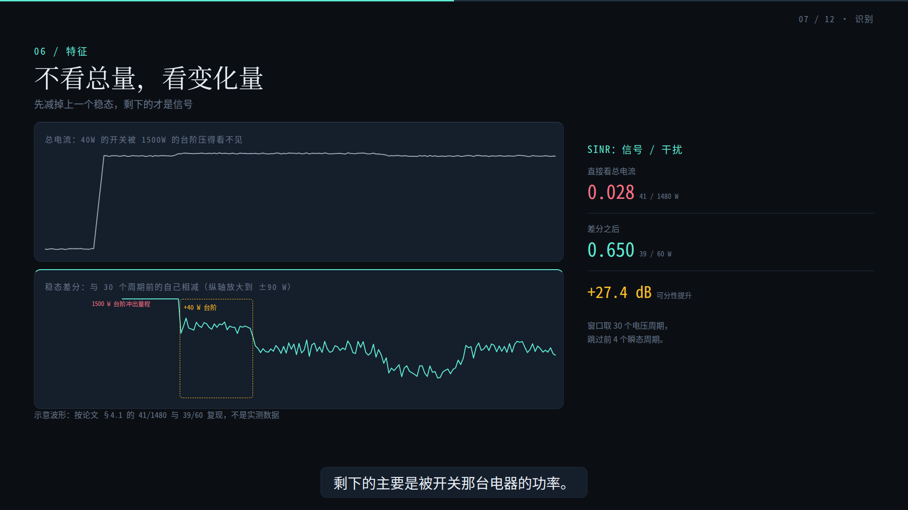
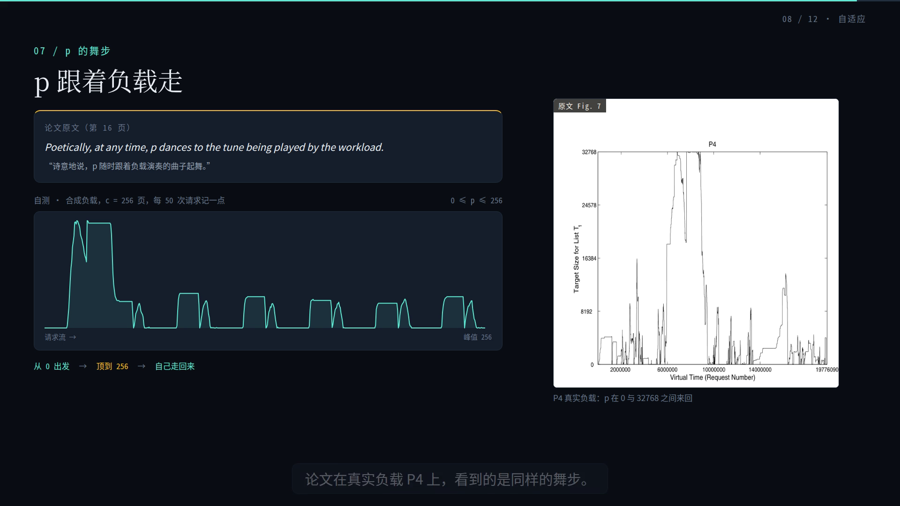
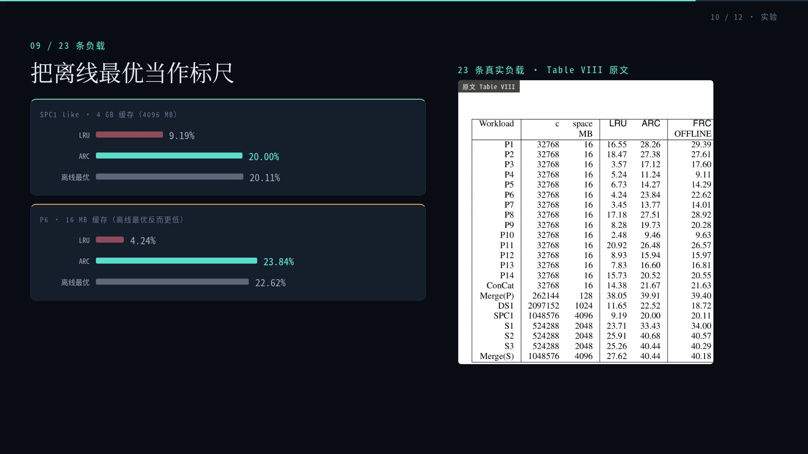

# video-pipeline-blueprint

A verified, reproducible blueprint for a **code-driven video pipeline**: the storyboard is data,
the picture is code, the sound is generated, and acceptance is measured instead of argued.

This repository is not a library. It is a **reference deployment + field report**: one production
(305 s algorithm lecture, Mandarin narration, programmatic score) that was built end to end on a
single 8 GB laptop GPU, with the exact environment, scripts, failure modes and quality gates that
made it work. Everything here was executed; numbers below were measured, not estimated.

```
Status: reference implementation, v1.0.0. Demo: 305 s / 1920x1080 / 30 fps / h264 + aac,
integrated loudness -15.1 LUFS, true peak -1.8 dBTP, 41 narration lines.
```

**Watch it first:** [the demo film](https://github.com/Xian-debu/video-pipeline-blueprint/releases/download/v1.0.0/quicksort_v3.mp4)
(14.6 MB, release asset) - then read how it is guaranteed to render the same way every time.

## 中文速览

这是一个**经过实测验证**的代码驱动视频管线部署包：分镜是数据（JSON/TS），画面是代码（Remotion/React），
声音是本地合成的（IndexTTS-2 旁白 + 种子确定性配乐），验收靠测量而不是靠嘴（EBU R128 响度、逐帧亮度
闪烁检测、静帧人工复核）。本仓库收录的是四部完整生产案例——305 秒快速排序教学片、588 秒「逐位乘法演进」科普片、
333 秒齿轮 3D 解析片、757 秒「别人论文的解读片」（SenSys '24 的 Hawk）——以及让它们跑起来所需的
脚本、环境说明、失败模式和验收关卡。四部片子共用一套门禁，片单只有一处真源：`scripts/film_registry.mjs`。

不是库，不是 SaaS，不是一键安装器。目标是：克隆下来，`bash scripts/bootstrap.sh` +
`npm run verify` 在参考机上约十分钟得到 PASS（25 道门，含 59 帧静帧渲染），然后照着 `docs/deployment.md` 换成你自己的内容。
坑都在 `docs/known-issues.md`（K1–K33），没有一条是假设出来的。

## 1. What this is, and what it is not

| It is | It is not |
| --- | --- |
| A deployment guide whose every step has been run on a clean directory | A hosted service, SaaS, or a one-click installer |
| A working Remotion project (generic storyboard + validated lecture) | A video editing GUI |
| Objective QA gates: EBU R128 loudness, per-frame luma flicker detection, still-frame review | An "AI makes your video" wrapper |
| Honest notes on what broke and why (see `docs/known-issues.md`) | A claim that any of this is trivial |

The core idea is simple: **a frame is a pure function of (data, frame index)**. If that holds,
a video becomes testable — you can render frame 2500 in isolation, diff it, and re-render the whole
film deterministically. Almost every design decision here follows from that.

## 2. Verified result

The demo is a 5-minute lecture on quicksort (from intuition to optimisation to a full expected-case
proof), generated from:

- real execution traces: 34 partition steps on an 8-element array, captured from an instrumented
  Python implementation (no hand-drawn values),
- measured counters: 5 sort variants x 4 input patterns, n = 1000, on the same machine,
- 41 narration lines synthesized locally (IndexTTS-2) and re-timed against measured speech lengths,
- a 306 s score rendered deterministically from a seed (same seed => identical wav bytes).

| Property | Measured |
| --- | --- |
| Runtime | 305.100 s, 30 fps, 1920x1080 |
| Video | h264, yuv420p |
| Audio | aac 48 kHz, I = -15.1 LUFS, TP = -1.8 dBTP |
| Full render time | ~5 min on the reference machine (2 concurrent renderers) |
| Flicker gate | max single-frame luma delta 9.68 (< 12 threshold) |
| Reproducibility | same seed => same music bytes; stills are frame-exact |

### Stills from the verified run

| | |
| --- | --- |
|  |  |
| Trace scene: real partition steps, live pivot slot, per-step counters | Proof scene: six numbered KaTeX lines, key step, measured check |
|  |  |
| Generic `Storyboard` composition driven by storyboard JSON | Contact sheet of the 30 s `Showreel` (the verify artefact) |

The same template in two other presets — [paper](docs/images/still_preset_paper.png) (dark on light)
and [slate](docs/images/still_preset_slate.png) (cool dark) — is how a look gets reviewed: one still
per preset, rendered by the same code path, checked by the same DOM rules.

### The second film: digit-wise multiplication

`Multiplication` (composition id `Multiplication`, doc `docs/multiplication.md`) is a 9-minute-48
explainer on how computers multiply big numbers: schoolbook n² → Karatsuba → Toom-3 → FFT/NTT →
the constant-factor magic real libraries use. Every number on screen is either counted by a script
(`data/mult/*.json`, regenerated by `scripts/generate_mult_data.py`) or measured on the reference
machine; the four proofs are typeset with KaTeX, and the code scene highlights the line CPython is
actually executing.

| Property | Measured |
| --- | --- |
| Runtime | 587.900 s, 30 fps, 1920x1080 |
| Audio | aac 48 kHz, I = -15 LUFS, TP = -2 dBTP |
| Narration | 106 lines, IndexTTS-2, re-timed against measured speech (`587.87 s`, 0 overruns) |
| Flicker gate | max single-frame luma delta 8.74 across 9 hard cuts (threshold 12) |
| Deliverables | 106 SRT cues (0 wrapped), 10 chapters, cover |
| sha256 | `af276de189cbf923684f986f65ff950d8e4455c91e088ff8079762b92e3ced17` |

| | |
| --- | --- |
|  |  |
| The strengthened induction (guess `c·nᵖ − 2dn`, not `c·nᵖ`, or the step cannot close) | Same-machine benchmark; the CPython bar and the growth table come from one measurement |

### The third film: gears, built rather than imported

`Gears` (composition id `Gears`, doc `docs/gears.md`) is a 5-minute-33 3D-first explainer:
why a tooth is an involute, why conjugate flanks keep the ratio constant, what a planetary set does
to that ratio, and where backlash and module come from. It is the first film whose **picture is the
same arithmetic the gate checks**: `data/gears/params.json` is the only place a number is written,
`scripts/generate_gear_data.py` derives every table from it, and `profile.ts` builds the tooth
flanks the film rotates from the same parameters — so `geometry_check.mjs` is not checking a
description of the picture, it is checking the picture.

| Property | Measured |
| --- | --- |
| Runtime | 332.8 s, 30 fps, 1920x1080 (9,983 frames) |
| 3D share | 86.7 % of the runtime weighted 3D (floor 60 %); flat scenes 18.3 % (ceiling 40 %) |
| Narration | 64 lines, IndexTTS-2, re-timed against measured speech (0 overruns) |
| Geometry gate | 8 invariants: involute identity 7.1e-15, contact ratio 1.6558, Willis -2.5000 |
| Mesh gate | 0 profile crossings over a tooth pitch; the gate proves it can fail (37/37 when half a tooth off) |
| Audio | aac 48 kHz, I = -15 LUFS, TP = -2 dBTP; narration 64 lines, 0 overruns |
| Flicker gate | mean\|Δ\| 0.0288, p99 0.1209, max 35.24 across 10 declared hard cuts (threshold 12) |
| Deliverables | 64 SRT cues (0 wrapped), 11 chapters, cover |
| sha256 | `458d15f08137e001433810ec1dcdfb8b369383f8eddb16d84c6beb95c4b993ef` |

### The fourth film: someone else's paper, read out loud

`Hawk` (composition id `Hawk`, doc `docs/hawk.md`) is the first film whose subject is not my own
material: a 12-minute reading of *Hawk: An Efficient NALM System for Accurate Low-Power Appliance
Recognition* (SenSys '24, CC BY 4.0) for a viewer who has never opened the paper. It is also the first
film where the expensive part is **not** the renderer: eleven numbers had to be traced back to a line in
the PDF after the film already passed every gate (K25), and one pre-computed difference series had to be
thrown away because it argued the opposite of the slide it was drawn on (K26).

Two paper figures are used as-is — the title page and the synchronisation-error CDF — cropped with
`annots=False` so the highlighter marks on the annotator's copy cannot leak into the film. Everything
else is drawn: the balanced Gray-code table, the shared-voltage clock, the 30-cycle difference, the vote
board, the latency table.

| Property | Measured |
| --- | --- |
| Runtime | 757.37 s, 30 fps, 1920x1080 (22,721 frames) |
| Scenes | 12: problem, paper, four concepts, dataset, sync, difference, vote, evaluation, limits, OSS, outro |
| Narration | 149 lines, IndexTTS-2, content-addressed clips (13 re-synthesised after the fact-check, 136 reused), 0 overruns |
| Source ledger | `data/hawk/eval.json`, hand-written, every value carries the table it came from; 11 corrections recorded in `docs/hawk.md` §5 |
| Claims gate | `data/hawk/claims.json`: 82 rows, each with the verbatim sentence from `paper.txt`; `claims_check.mjs` proves the quote occurs in the extracted text and the value occurs in a ledger (7 paper-only values are marked as such, in writing) |
| Paper plates | 2 of 8 crops used; `page.get_pixmap(annots=False)` + a yellow-pixel count of 0 |
| Synthetic data | `wave.json` is flagged `synthetic: true` and says so on screen; the Gray-code sequence is derived, labelled as such |
| Audio | aac 48 kHz, I = -15 LUFS, TP = -2 dBTP; mix gate speech -15.42, gap -25.20 |
| Flicker gate | mean\|Δ\| 0.0171, p99 0.1234, max 25.99 across 11 declared hard cuts (threshold 12) |
| Deliverables | 149 SRT cues (0 wrapped), 12 chapters, cover |
| sha256 | `f44aa3a96f397ef1a091a077ccb4a9b9bf44df1e60dd5e914a8bde3528295e5a` |

| | |
| --- | --- |
|  |  |
| The paper's own first page, badge `原文 第 1 页`, with the five authors and both institutions named in the film | The difference panel: the 1500 W step leaves the axis, the +40 W plateau is boxed — computed in the component, not read from a file |

### The fifth film: an algorithm you can re-run

`Arc` (composition id `Arc`, doc `docs/arc.md`) reads *ARC: A Self-Tuning, Low Overhead Replacement Cache*
(Megiddo & Modha, FAST '03, pp. 115–130, USENIX open access) in 611 s. Unlike the Hawk film, the
subject here is an **algorithm with four cases and a subroutine**, so the film's spine is not a sequence
of results but the algorithm itself: the two LRU lists, the ghost directory of 2c entries, the policy
class Π(c), and then Figure 4 case by case. Two things make it a paper reading rather than a paraphrase:
Figure 4 is executed (a Python simulator implements it literally, and every curve on screen comes from
that run, seed fixed, two runs byte-identical), and the numbers are audited (32 rows in
`data/arc/claims.json`, each number with the sentence that sources it).

The most expensive correction happened before the film existed: a text-extraction of Figure 4 put the
`else` branch of Case IV in the wrong place, so the reimplementation called `REPLACE` twice on a miss and
the hit ratio collapsed to 1.15 % — the fix came from reading the algorithm image at 300 dpi, not from
reading the OCR text (K33).

| Property | Measured |
| --- | --- |
| Runtime | 610.57 s, 30 fps, 1920x1080 (18,317 frames) |
| Scenes | 12: open, problem, gap, concepts, double-cache, policy class, ARC(c), adaptation, scan resistance, measurement, universality and limits, outro |
| Narration | 123 lines, IndexTTS-2 with `--fp16` (3 s/line; without it, 310 s for the first line alone), 0 overruns |
| Source ledger | `data/arc/eval.json`: every number hand-copied from Tables I–VIII with `where` naming the table; P4's offline FRC read 11.60 off the table image because OCR turned it into "OAL" |
| Claims gate | `data/arc/claims.json`: 32 rows over 12 scenes; `claims_check.mjs --film=arc` proves the quote occurs in `paper.txt` and the value occurs in a ledger |
| Derived data | `sim.json`: a literal implementation of Figure 4 (ARC, LRU, FRC_p at p = 0/25/50/75/100) over 120,000 synthetic requests, 4,000 pages, three alternating phases; `scan` uses a 6,000-request hot set, 3,000 sequential pages, then the same hot set again (ARC 40 % vs LRU 18 % on the first 100 post-scan requests) |
| Paper plates | 8 crops generated (title, proceedings cover, Fig. 1, Fig. 2, Fig. 3, Fig. 4, Fig. 7, Table VIII), 6 used; `annots=False` plus a yellow-pixel count of 0.0000; Table VIII needed four crops before all 23 rows were inside the frame |
| Audio | aac 48 kHz, I = -15 LUFS, TP = -2 dBTP; mix gate speech -15.44, gap -28.81, bed 41.2 dB |
| Flicker gate | mean\|Δ\| 0.0336, p99 0.2034, max 67.15 across 11 declared hard cuts (threshold 12) |
| Deliverables | 123 SRT cues (0 wrapped, longest 34 chars), 12 chapters, cover frame 180 |
| sha256 | `fa24989fd52cec618dc7163cfd2182e73d9ef73fb2e8056a99bfa7f414b9a6a2` |

| | |
| --- | --- |
|  |  |
| p over a synthetic trace (c = 256): it walks to 256 and back — the film's own run, not the paper's Figure 7, which sits beside it as the plate | The paper's Table VIII as the yardstick, with SPC1 and P6 re-drawn as bars: ARC 20.00 % against LRU 9.19 %, and P6 where the offline optimum is *below* ARC |

## 3. Pipeline at a glance

```
data/lecture/*.json ──► src/lecture/script.ts ──► src/lecture/Lecture.tsx ──► Remotion render
(real traces)      (scene budget, lines)       (scenes + subtitles)         │
                                                                             ├─► stills (human review)
IndexTTS-2 ──► public/voice/lNN.wav ──► narration.wav ──────────────────────┤
node-web-audio-api ──► public/music/score.wav ──► mix.mjs (duck, fades) ──────┤
                                                                            ▼
                                                              ffmpeg loudnorm (EBU R128)
                                                                            │
                                                              luma_blink.py (flicker gate)
```

Three independent layers, joined only by files:

1. **Content** — storyboard JSON or a typed `script.ts`; scene durations and speech lines are data.
2. **Rendering** — React/TSX components driven exclusively by `useCurrentFrame()`; no CSS
   animations, no third-party self-running animation, so any frame can be rendered in isolation.
3. **Sound** — a deterministic score (seeded PRNG, `node-web-audio-api`) and a locally synthesized
   narration track, mixed outside the renderer (`scripts/audio/mix.mjs`: ducking, fades, peak guard)
   and normalised with ffmpeg. A score is only "there" if it survives a 300 Hz high-pass, so
   `scripts/qa/music_gate.py` measures the band that actually reaches a laptop speaker.

## 4. What is in the box

```
.
├─ src/
│  ├─ Root.tsx                 registered compositions (16)
│  ├─ storyboard/              generic template: storyboard JSON -> film
│  ├─ lecture/                 the validated 305 s lecture (script + scenes)
│  ├─ mult/                    the second film, 588 s: digit-wise multiplication (script + scenes)
│  ├─ gears/                   the third film, 333 s, 3D-first: gears (script, involute profile,
│  │                           scene components; the geometry is computed, not imported)
│  ├─ hawk/                    the fourth film, 757 s, paper reading: shared.tsx (scene furniture,
│  │                           beat helpers) + scenes/ (one file per scene) + script.ts (timeline)
│  ├─ arc/                     the fifth film, 611 s, paper reading with an executed algorithm:
│  │                           same shared.tsx / scenes/ / script.ts layout as hawk
│  ├─ design/                  design contract loader + derived tokens, palette scope (presets),
│  │                           scene shell, KaTeX helpers, motion primitives, 3D primitives
│  │                           (canvas, lights, camera rigs, materials, glTF model), still-lint
│  │                           probe (inert unless lint props are set)
│  └─ showcase/                one-file samples: transitions, typesetting, ThreeCube, ThreeStage
│                              (procedural / imported / composited 3D), PlateStage (consumes
│                              Blender plates), PropStage (generated SDF props), Manim overlay,
│                              preset gallery (one look per preset)
├─ data/                       shared contract only: design.spec.json, type-exceptions.json
│  ├─ lecture/                 the quicksort film's own facts: trace, counters, source, voice timing
│  ├─ mult/                    the multiplication film's own facts: counts, benchmarks, NTT, code, voice
│  ├─ gears/                   the gears film's own numbers: one params.json, then every table
│  │                           (centre distance, contact ratio, Willis, backlash) derived from it
│  └─ hawk/                    the paper film's ledgers: eval.json (hand-copied from the PDF, with
│                              the table it came from), claims.json (one row per number, with the
│                              verbatim sentence), paper.txt (the extracted text the gate quotes),
│                              crops.json; gray.json + wave.json are derived and never committed
├─ public/voice/sample.wav     one narration line, kept so the audio path can be tested without TTS
├─ public/models/              nailong_v3_15k.glb (262 KB, smoothed, watertight, no normals) and
│                              prop_{gear,chip,nut}.glb (SDF/CSG, watertight, generated)
├─ scripts/
│  ├─ bootstrap.sh             system libraries, node, npm, headless Chromium
│  ├─ doctor.sh                read-only environment report (PASS/FAIL)
│  ├─ verify.sh                end-to-end smoke test: typecheck -> stills -> render -> QA
│  ├─ make.mjs                 one command for one delivery: every gate, in order, into report.json
│  ├─ film_registry.mjs        the only list of films: script, export prefix, data generators,
│  │                           derived (uncommitted) data. make.mjs and still_lint.mjs both import it
│  ├─ render_scenes.mjs        scene-by-scene picture render: hash the inputs, reuse, concat
│  ├─ generate_data.py         regenerates data/lecture/*.json from instrumented implementations
│  ├─ generate_mult_data.py    the same for the multiplication film: counts, benchmarks, trace
│  ├─ generate_gear_data.py    every gears table from data/gears/params.json (derived, not committed)
│  ├─ generate_hawk_data.py    the paper film's Gray-code schedule and synthetic waveform (seeded)
│  ├─ assets/hawk_paper.py     crops the paper's figures with PyMuPDF (annots=False, --fail-on-annots)
│  ├─ audio/render_music.mjs   deterministic score renderer
│  ├─ audio/mix.mjs            narration + score mix: ducking, fades, peak guard (no re-render)
│  ├─ audio/loudnorm.sh        two-pass EBU R128 normalisation (video stream untouched)
│  ├─ qa/music_gate.py         score audibility: power in 250-4k Hz, and the bed level in pauses
│  ├─ qa/luma_blink.py         per-frame luma jump + dip detector
│  ├─ qa/design_check.py       validates the design contract (contrast, scale, families, motion)
│  ├─ qa/type_ratchet.py       no new hard-coded font sizes: the exception list may only shrink
│  ├─ qa/still_lint.mjs        renders frames, reads the DOM boxes, fails on off-frame/edge/spill/overlap
│  ├─ qa/model_lint.mjs        parses a GLB without three.js: triangle budget, extent, watertight
│  ├─ qa/three_frame_lint.mjs  renders 3D frames and measures coverage / black / determinism
│  ├─ assets/smooth_glb.mjs    dependency-free Taubin smoother for carved/voxel meshes
│  ├─ assets/sdf_props.mjs     SDF/CSG props -> surface nets -> watertight GLB (geometry as code)
│  ├─ blender/render_plates.py offline plates without Blender's GUI: scene, camera by frame
│  │                           number, report.json with a sha256 per frame (Blender is optional)
│  ├─ qa/plate_lint.mjs        plate set integrity: contiguous frames, byte/sha match, duration
│  ├─ qa/film_isolation.mjs    one film may not read another film's data or source (layout rule)
│  ├─ qa/film_coverage.mjs     every src/*/script.ts is registered, every registered film exists
│  ├─ qa/derive_data.mjs       runs the generators a film names, so a clean clone has its data
│  ├─ qa/derived_check.mjs     derived JSON must not be tracked by git
│  ├─ qa/claims_check.mjs      every number in the paper film has a quote that is really in paper.txt
│  ├─ qa/tree_hash.mjs         one hash for the tree that a run is about to measure
│  ├─ export/publish.mjs       SRT + chapters + cover, all derived from a film's script
│  └─ tts/                     local TTS: batch synthesis, re-timing, torchaudio patch
├─ docs/                       architecture, engineering standards, design language (provenance of
│                              the contract), deployment, verification, known issues, roadmap, and
│                              one file per film (lecture, multiplication, gears, hawk) plus 3d.md,
│                              blender-plates.md, sdf-assets.md, environments.md
├─ AGENTS.md                   rules for AI agents working in this repo
├─ CONTRIBUTING.md             how to change things, and what "done" means here
├─ package-lock.json           pinned dependency tree (306 packages, installed with npm ci)
└─ THIRD_PARTY_NOTICES.md      licences: npm packages, system tools, TTS models, reference reading
```

**Docs, all of them:** [3d](docs/3d.md) · [architecture](docs/architecture.md) · [blender-plates](docs/blender-plates.md) · [deployment](docs/deployment.md) · [design-language](docs/design-language.md) · [engineering-standards](docs/engineering-standards.md) · [environments](docs/environments.md) · [gears](docs/gears.md) · [arc](docs/arc.md) · [hawk](docs/hawk.md) · [known-issues](docs/known-issues.md) · [multiplication](docs/multiplication.md) · [roadmap](docs/roadmap.md) · [sdf-assets](docs/sdf-assets.md) · [verify-report](docs/verify-report.md).

**Source data vs derived data.** Some JSON under `data/` is written by hand and is the only place a
number exists (the design contract, each film's `params.json`/`eval.json`/`crops.json`, the measured
`voice.json`). The rest is a pure function of those files (`data/gears/*.json` except params/voice,
`data/hawk/gray.json` + `wave.json`) and is **not committed** — `scripts/film_registry.mjs` names the
generator for each, `make` and `verify` run it before anything imports the output, and
`derived_check.mjs` fails when a derived file is tracked by git. The rule exists because a stale
committed table is a table nobody regenerates: the number on screen and the number in the file drift
apart silently. `data/hawk/paper.txt` is the exception that proves the rule — it is committed (CC BY
4.0, 125 KB) because `claims_check.mjs` has to be able to quote it; a ledger that cannot be checked
is decoration.

Compositions (16): the five films `Lecture` (305 s), `Multiplication` (588 s), `Gears` (333 s),
`Hawk` (757 s), `Arc` (611 s); the template and the verify artefact `Storyboard` (20 s) and `Showreel` (30 s);
the single-capability samples `Transitions`, `Typesetting`, `ThreeCube`, `ManimOverlay`,
`ThreeStage` (30 s: procedural geometry, an imported `.glb`, and a transparent 3D layer over 2D
text), `PlateStage` (3 s: consumes a Blender-rendered plate sequence; needs `npm run plates` first,
and says so when the plates are missing), `PropStage` (5 s: three props that exist only as CSG
expressions, built by `npm run props`), `Presets` (9 s: the same title scene in each palette preset),
and `LintFixtures` (dev only: frames that are *supposed* to fail the DOM rules).

One command runs the whole delivery. `npm run make` walks the stages in the order that makes a
failure cheapest to fix — contract, score, score gate, picture-only render, review stills, still
lint, mix, mix gate, mux, loudnorm, flicker, exports — and writes `out/<name>/report.json` with the
exit code of every stage and every measured number (loudness, true peak, flicker max, still box
counts). A failing stage stops the run and still writes the report, so a failure is a file, not a
scrollback. The score is generated *before* the picture on purpose: a bed that fails the audibility
gate must not be able to reach a render.

```bash
npm run make -- --composition Lecture --narration public/voice/narration.wav --skip-static
npm run make -- --composition Storyboard --cut-frames 120,240,270   # a template with hard cuts
```

**Editing one paragraph re-renders one scene.** A film's picture is rendered scene by scene
(`scripts/render_scenes.mjs`): each scene's inputs are hashed (its own lines, its index and the scene
count, the film's components, the film's data JSON, the shared design system) and a segment whose
hash still matches is reused. Segments are concatenated with `-c copy`, so untouched scenes cost
nothing but a file read:

```bash
node scripts/render_scenes.mjs --composition=Multiplication --script=src/mult/script.ts \
  --out=out/package/scenes --output=out/package/raw_video.mp4
# first run:             RENDER reused=0 rendered=10 scenes=10 frames=17636
# after nothing changed: RENDER reused=10 rendered=0 scenes=10 frames=17636
```

`npm run make` uses it for every film in `scripts/film_registry.mjs` and records the counts in
`report.json` (`numbers.segments`). The score is reused the same way, keyed on its generation
parameters in `score.meta.json`, because a 10-minute bed costs 19 minutes to synthesize. Only
`--force-render` ignores the segment cache.

**The report says which tree it measured.** `node scripts/qa/tree_hash.mjs` prints one hash over
everything that can change rendered bytes (`src/`, `data/`, `scripts/`, render config). When the
gates run on a copy of the repo somewhere else, pass the original's hash: `--expect-tree <hash>`
makes the run fail in the first second instead of after a stale long render.

The film's delivery set is `npm run publish` (or the last stage of `make`): `out/export/` gets an
SRT wrapped to the contract's 34-character line budget, human-readable and ffmpeg-sidecar chapter
files summing to the film's duration, and a cover. Everything is derived from the film's script, so
nothing in that folder can drift from the picture. Per film: 41 cues / 9 chapters / cover 180
(lecture), 106 / 10, 64 / 11, 149 / 12 (Hawk). The flags are `--composition`, `--script`,
`--prefix`, `--cover-frame`.

Type is a contract question, not a scene one. The storyboard template reads `SB.*` and `SB_T.*`
(sizes, tracking) from `type.families.storyboard`, the multiplication film reads `FT.*` from
`type.families.film`, and the showcase HUD reads `SC.*` / `SC_T.*` from `type.families.showcase` —
so changing a surface's type means editing one JSON file. The validated film's own sizes are
*grandfathered* in `data/type-exceptions.json` (52
literals across 9 files, mostly the lecture's chrome) rather than promoted into the contract, and
`scripts/qa/type_ratchet.py` fails the build when a literal is added, duplicated or left stale — the
list can only shrink.

Colour is a preset of the same role contract. A scene names a role (`text.primary`,
`accent.primary`, `surface.scrim`) and never a hex value; `PaletteScope` decides which family
answers those roles. `palette.presets` in the contract names the looks — `midnight` (the shipped
film's family, and the pinned default), `paper` (light, warm) and `slate` (cool) — and
`design_check.py` runs every preset family through the same contrast rules, then refuses a default
that is not the family the released film was reviewed in. Switching a look is one prop:

```bash
node scripts/qa/still_lint.mjs --compositions Presets --frames 135   # the paper look, DOM-checked
npx remotion render Storyboard out/paper.mp4 --props='{"preset":"paper"}'
```

## 5. Quick start

```bash
# 0. prerequisites: Debian/Ubuntu, ffmpeg, python3 + numpy, ~5 GB free disk; sudo for the apt step
#    (bootstrap.sh installs all of these; the QA gate needs numpy)
git clone <this repo> && cd video-pipeline-blueprint
bash scripts/bootstrap.sh        # apt libs + CJK fonts + node + npm + headless Chromium
bash scripts/doctor.sh           # must print "all checks passed"
npm run verify                   # ~10 min on the reference machine: 25 steps, 59 still-lint frames,
                                 # a 30 s film, loudness + flicker gates (it used to be 2 min when
                                 # there was one film and no 3D/plate/prop gates)
```

Expected tail of `npm run verify`:

```
integrated loudness = -15.XX LUFS, true peak = -2.XX dBFS
PASS loudness
... flicker: PASS
verify: PASS — stills in out/verify/, video in out/verify/showreel_norm.mp4
```

Then:

```bash
npm run studio                                   # live preview in the browser
npx remotion still Lecture out/frame_2500.png --frame=2500 --props='{"music":null,"narration":null}'
npx remotion render Lecture out/lecture.mp4      # needs public/music/score.wav (see docs/deployment.md)
```

## 6. The environment this was built on

| Item | Value |
| --- | --- |
| Host | Windows 11 + WSL2 (Ubuntu 24.04.2 LTS), mirrored network mode |
| GPU | NVIDIA RTX 5070 Laptop, 8 GB VRAM, driver 591.44 |
| CPU / RAM | 20 logical cores / 54 GB (WSL limit) |
| Node | v22.21.1 (tarball, not the distro package) |
| Remotion | 4.0.536, Chromium renderer `angle` |
| ffmpeg | 6.1.1 |
| Python | 3.12.3; a side venv holds Manim 0.22 and the TTS stack |

**How these long jobs are controlled** matters as much as the versions:

- Renders are single-shot CLIs; they are *not* run from an interactive shell that can die.
  On the reference machine every long job runs under a supervisor:
  `systemd-run --unit=lecture --collect --property=StandardOutput=file:/tmp/lecture.log ...`
  and progress is read from the log. Detaching with `nohup`/`setsid` from a session that then
  exits lost processes in our tests.
- The pipeline never polls an LLM or a remote API during a render; the render is a pure function,
  so a retry costs only wall-clock time.
- Peak VRAM is dominated by the TTS model (~7.9 GB of 8 GB). **Do not run TTS and a 3D render
  concurrently on an 8 GB card.** Rendering itself is CPU-bound and does not need the GPU.
- Headless Chromium on WSL2 needs the shared libraries listed in `scripts/bootstrap.sh`; the
  renderer uses ANGLE for WebGL, which is also what makes 3D scenes work on an 8 GB machine.

## 7. Models, libraries and the relationship to upstream projects

This repository contains **only original code and data**. It does not vendor, mirror, or
re-license any third-party weights or sources; every dependency is installed by the user from
its own upstream under its own license.

| Upstream | Role here | License (upstream) | Relation |
| --- | --- | --- | --- |
| [Remotion](https://github.com/remotion-dev/remotion) 4.0.536 | React-based video renderer; every composition | Remotion License (free for individuals/small teams; check company terms) | Unmodified dependency; this repo is an application built on its public API |
| [React](https://github.com/facebook/react) 19 / [three.js](https://github.com/mrdoob/three.js) / [react-three-fiber](https://github.com/pmndrs/react-three-fiber) | scene components, 3D sample | MIT | dependency |
| [KaTeX](https://github.com/KaTeX/KaTeX) | math typesetting in the proof scene | MIT | dependency |
| [Manim Community](https://github.com/ManimCommunity/manim) 0.22 | optional: animated formula overlay (alpha) | MIT | external renderer, its output is imported as a video asset |
| [IndexTTS-2](https://github.com/index-tts/index-tts) | local Mandarin narration | Apache-2.0 (check upstream) | external model runtime; weights are downloaded by the user, never committed here |
| [torchaudio](https://github.com/pytorch/audio) / [soundfile](https://github.com/bastibe/python-soundfile) | audio IO in the TTS path | BSD-2 / BSD-3 | dependency; one compatibility patch is applied by a script, not vendored |
| [node-web-audio-api](https://github.com/ircam-ismm/node-web-audio-api) | offline score synthesis | BSD-3 | dependency |
| [ffmpeg](https://ffmpeg.org) | loudness measurement/normalisation, encoding checks | LGPL/GPL depending on build | external binary |
| [Noto fonts](https://github.com/notofonts/noto-cjk) | CJK typography | OFL-1.1 | installed as a system font, not bundled |
| [remotion-skills](https://github.com/buainoai/remotion-skills) | external best-practice rules consulted while building | see upstream | **not** included; referenced as reading material |

Deliberately not used: the official `@remotion/mcp` (it only forwards documentation to
`mcp.remotion.dev`; it does not render), Tone.js (its `OfflineAudioContext` path is unusable in
Node — see `docs/known-issues.md` K2), and any cloud TTS.

## 8. Verification: what `npm run verify` actually proves

```
0.5  derived data       film_coverage.mjs (every src/*/script.ts is registered) -> derive_data.mjs
                        (run the generators a film names) -> derived_check.mjs (derived JSON is
                        not tracked by git)
0.6  claims ledger      claims_check.mjs: every number in data/hawk/claims.json has a quote that
                        really occurs in data/hawk/paper.txt, and the value occurs in a ledger
0.7  docs anchors       docs_check.mjs: the README's own counts (compositions, films, steps, K
                        index, doc links) agree with the tree
1/6  typecheck          tsc --noEmit
1.1  film isolation     film_isolation.mjs: a film may not read another film's data or source
1.2  design contract    design_check.py: contrast ratios, type ladder + families, tracking
                        ratios, motion budgets
1.3  type ratchet       type_ratchet.py: no new hard-coded fontSize/letterSpacing literals
1.5  headless browser   remotion browser ensure (downloads once)
2/6  still frames       Storyboard f60, Lecture f2500, Typesetting f60  -> human review
2.5  still lint         still_lint.mjs: 71 frames measured from the DOM (12 Hawk + 12 Arc + 11 Gears +
                        9 Lecture + 10 Mult + 17 showcase; one per scene) + fixtures that prove
                        the rules still fire
2.6  model lint         model_lint.mjs: GLB structure, triangle budget, extent, watertight
2.7  3D frames          three_frame_lint.mjs: coverage floor/ceiling, not black, sha256 twice
2.8  plate set          plate_lint.mjs: frames contiguous, every PNG byte/sha matches report.json,
                        report count == PlateStage duration (skipped with a reason when absent)
2.9  generated props    lint:props: every prop_*.glb parses, stays under the triangle budget,
                        and is watertight (boundary edges = 0, non-manifold edges = 0)
2.10 gear geometry      lint:geometry: 8 invariants of the gears film's own tooth profiles
                        (centre distance, base circle, involute identity, contact ratio, Willis)
2.11 gear meshing       mesh_check.mjs: no profile crossings over a tooth pitch, and a half-tooth
                        phase error is still caught (the gate proves it can fail)
2.12 3D budget          lint:budget: weighted 3D share >= 60%, pure-2D <= 40%, each scene 20-60 s
2.13 gear 3D frames     three_frame_lint.mjs --composition=Gears: coverage, not black, sha256 twice
3/6  score              deterministic wav from seed 11 (32 s)
3.4  music self-test    music_gate.py --self-test: a sub-only bed must still be rejected
3.5  music gate         music_gate.py: >= 50% of power in 250-4k Hz, <= 20% in 20-120 Hz
4/6  render             Showreel 30 s, h264 + aac
5/6  loudness           two-pass loudnorm; asserts I in [-16,-13] and TP <= -1.5
6/6  flicker            per-frame luma jumps on the whole frame (threshold 12)
```

That is 25 steps in `scripts/verify.sh` (a film added to the tree but missing from
`film_registry.mjs` fails 0.5 rather than silently skipping every gate — that is K27).

The design-contract step is cheap and catches the class of defect that is cheapest to fix before a
render: a role that fails contrast on one of its real backgrounds, a type size that is not on the
ladder, a motion duty whose budget exceeds its cap. It prints every measured ratio, so a reviewer can
see the margin rather than the verdict.

The still-lint step is the machine version of "look at the frame", for the four failures a machine
can name: a box outside the 1920x1080 canvas, text closer than 24 px to the edge, a text range wider
than the box it was given, and two text boxes sharing more than a quarter of the smaller one. It does
not try to judge taste, and it cannot be fooled by a frame with no measurement — a frame that reports
zero boxes is a **failing** gate (exit 2), not a pass.

What it does **not** prove: narration quality (needs the TTS model), Manim overlay (needs the asset),
or 3D on a GPU-less host. Those are separate, optional passes in `docs/deployment.md`. The 3D
gates (`docs/3d.md`) prove that a frame was *drawn*, not that the right object was drawn — an empty
studio passed every one of them (K20); the still review is what caught it.

The stills are not decoration. In this production, two defects that every automated metric passed —
a subtitle overlapping a title, and four proof panels leaving the frame — were only caught by
looking at rendered frames. Treat "human reviews stills" as a required stage, not a nice-to-have.

## 9. Known issues

Full detail in `docs/known-issues.md` (K1–K33); the short list, oldest first:

- **K1 cross-fade flicker**: `TransitionSeries` keeps both scenes visible for the overlap and
  multiplies two opacities, producing a visible dip. Fixed by hard cuts + per-scene content fades.
  The luma gate did **not** catch it (it is an area/motion illusion, not a mean-luma jump) — so the
  gate alone is insufficient; hard cuts are the design rule. Two follow-ups from the same defect:
  the background is painted by each scene and never fades (only content fades), and consecutive
  scenes stay in one low-luminance palette family.
- **K2 Tone.js cannot render offline in Node**: no native `OfflineAudioContext`; shimming
  `standardized-audio-context` fails parameter validation. Replaced by direct
  `node-web-audio-api` synthesis.
- **K3 torchaudio >= 2.9 needs TorchCodec** for WAV IO; `save_pcm_wav()` fails without it.
  Worked around by a documented patch script with a soundfile fallback.
- **K4 IndexTTS-2 pins python < 3.12 and torch 2.8**; the reference machine runs 3.12 + torch 2.9.
  Installing with `--no-deps` and sharing the main venv through a `.pth` file works, with
  `transformers==4.52.1` pinned in the side venv (4.57 removed `QuantizedCacheConfig`).
- **K5 downloading IndexTTS-2 weights**: HF direct is unreachable here; a library-internal
  ModelScope fallback raises 404 mid-download. Use a mirror + `USE_MODELSCOPE=false`.
- **K6 loudness parser**: ffmpeg's first-pass JSON uses `input_i`/`input_tp` keys; matching
  `measured_i` silently yields a broken filter chain. `scripts/audio/loudnorm.sh` matches the
  right keys.
- **K7 `TransitionSeries` eats frames**: with N scenes and fade length F, total duration is
  `sum(durations) - (N-1)*F`, otherwise the tail is black. The demo avoids transitions entirely.
- **K8 KaTeX display mode** fights a left-aligned panel; K9 long jobs die with their shell
  (use a supervisor); K10 npm scripts need `node` on PATH; K11 WSL2 disks do not shrink without
  `fstrim` + host-side compaction. Details in `docs/known-issues.md`.
- **K12 a trace field the renderer assumed**: the recorder emits `p` (final pivot slot) for
  `place` steps while the renderer read `i`, so one caption said "index undefined" and the pivot
  highlight vanished — invisible to every other gate, caught on a still. Fixed with accessors that
  read both spellings.
- **K20 a 3D canvas renders once per frame**: `@remotion/three` sets the R3F frameloop to `never`
  and advances once per frame, so a model that finishes loading after the canvas mounts is never
  drawn — deterministically, and with a ground plane that keeps the coverage gate green. Fix: load
  outside the canvas, hold the frame with `delayRender`, mount the canvas only when the scene graph
  is ready; paths must go through `staticFile()`.
- **K16 an induction that cannot close**: guessing `T(n) ≤ c·nᵖ` at `p = log₂3` leaves a zero
  remainder, so the step is false for every n; it shipped on a still that looked fine. Fixed by
  guessing the strengthened `c·nᵖ − 2dn`. **K17 `--out` became the string `"true"`**: a flag
  parser that only understood `--k=v` wrote a 114 MB score into a file named `true`.
- **K21 "it rendered" is not "the GPU rendered"**: `blender -b` has no display, so EEVEE silently
  falls back to Mesa's `llvmpipe` software rasteriser (a 64×64 probe took 8.82 s; the same probe on
  Cycles/CUDA took 0.43 s), and the Cycles engine does not even appear in the RNA engine enum under
  `--factory-startup`. Plates therefore render with Cycles, device resolution is reported by the
  probe, and `resolve_engine()` probes by assignment instead of trusting the enum. See
  `docs/blender-plates.md`.
- **K25 a number under the wrong label**: 71.5× was the baseline's cost, not this system's; 2304
  hours belonged to the baseline dataset, not this one; 5 ms was another paper's precision. Every
  gate passed. The fix is not a gate: one hand-written ledger, and reading the paper next to the
  screen (that ledger is `data/hawk/eval.json`, and K26's cousin `claims.json` now proves the
  quotes are real).
- **K26 a pre-computed series that argued the opposite**: the 30-cycle difference of a 1500 W step
  produces a −1500 W fake step when the step rolls out of the window, which says the reverse of the
  slide it is drawn on. Compute it in the component, clamp the axis, and let the +40 W plateau be
  found rather than asserted.
- **K27 a gate that measured a frame nobody saw**: `Fig` sized itself from the decoded image, but
  the lint probe measures before decode paints, so two captions "overlapped" on frames that render
  fine. Give the box an explicit height. Corollary: a film missing from `FILM_SCRIPTS` is a film
  every still gate silently skips — hence the single `film_registry.mjs` (0.5).
- **K28 a .gitignore rule that matched nothing**: the previous line had no trailing newline, so
  `*.logpublic/voice/hawk/` was a rule nobody could match and 26 MB of wav files showed up as
  untracked. Ask git (`git check-ignore -v`), do not read the file.
- **K29 documentation as a cache with no invalidation**: the README described 11 compositions while
  the tree registered 15, and no gate read it. Counts in prose now have a checker (`docs_check`).
- **K30 a two-column PDF extracted into one line**: `pdftotext -layout` merges columns, so a claim's
  quote has to be a single-physical-line slice — which is also why the claims gate can verify it.
- **K31 a metric that measured the wrong thing**: pacing first called "average frame difference < 0.5"
  static, which scores a line slowly being drawn as a freeze; fix the measurement before the film.
- **K32 a deployment package that was never deployed**: every gate ran in the working copy, so
  `public/music/` was present locally and absent from `git archive HEAD`. A package is verified
  only as a package: archive -> empty directory -> `npm run verify`.
- **K33 an algorithm read from a text dump**: OCR flattens the `If / else / endif` nesting of Figure 4,
  the reimplementation called `REPLACE` twice per miss, and the hit ratio came out at 1.15 %. Read
  pseudo-code as an image at 300 dpi; the text is an index into the picture, not the picture.

## 10. Choosing an environment (and lower-tier substitutes)

Difficulty is not uniform. See `docs/environments.md` for the full matrix; in short:

| Target | Feasibility | Notes |
| --- | --- | --- |
| Linux + NVIDIA GPU, >= 8 GB | Easy (this repo) | everything works as documented |
| Linux, no GPU | Easy **without** local TTS | rendering is CPU-only; use a cloud/offline TTS or captions-only |
| Windows native | Doable | Chromium libs are preinstalled, but the demo was never validated natively; prefer WSL2 |
| macOS (Apple silicon) | Doable | Remotion is fine; local IndexTTS-2 on MPS is unproven — use another TTS |
| 8 GB RAM / 2-core VPS | Painful | renders are 10-20x slower; reduce concurrency to 1, 720p, and expect ~1 h for 5 min |
| GPU-less + 16 GB RAM | Recommended fallback | drop 3D and Manim; TTS off-host; keep the rest |

Lower-tier substitutions (documented in `docs/environments.md`):

- **Narration**: edge-tts (online, free tier, needs network) or Piper (CPU, offline) instead of
  IndexTTS-2; the pipeline only needs *wav files with measured lengths* — `retime_narration.py`
  does not care which model produced them.
- **Music**: skip it, or reuse a fixed track; the score is 60 lines of JS and needs no GPU.
- **3D**: `@remotion/three` needs WebGL via ANGLE; on a machine where headless WebGL fails,
  replace the 3D scene with a still or a Manim clip.
- **Manim**: optional. It buys animated formulas at the cost of a TeX install (~1 GB).

## 11. Roadmap

See `docs/roadmap.md` (it also lists the open design-contract debts). Highlights: a single
orchestrator (`storyboard.json -> stills -> review -> render -> QA`), an index of reusable scene
components, optional GPU-free TTS integration, and pacing as a measured property (the Hawk film's
`scripts/qa/pacing.py` turned "does it feel slow?" into a number: longest static stretch per scene).

## 12. Contributing

The pipeline is a production, and contributions are held to the same bar as the film.

The design contract (`data/design.spec.json`) is the Rank-1 source of truth;
[`docs/design-language.md`](docs/design-language.md) explains where each of its rules came from
(including what was deliberately refused from the ppt-master reference) and lists the open debts.
Read [`docs/engineering-standards.md`](docs/engineering-standards.md) before changing anything: it fixes
the source-of-truth hierarchy (design contract -> tokens -> components), the determinism invariants,
the design and content rules, the definition of done, and the git discipline. `CONTRIBUTING.md`
has the short version and the review checklist; `AGENTS.md` is the same for coding agents.

What you are allowed to ship: [`THIRD_PARTY_NOTICES.md`](THIRD_PARTY_NOTICES.md) records the licence of
everything this package installs or calls, including the two that are easy to get wrong — Remotion is
under the Remotion License (free tier: individuals, non-profits, teams of up to three employees), and
the IndexTTS-2 weights are under the bilibili Model Use License Agreement, not an OSI licence.

## 13. License

Code and data in this repository: MIT (see `LICENSE`). Third-party components keep their own
licenses; the demo narration and score were generated by this pipeline.